# 🌍 Território Preditivo

<p align="center"><b>Painel de inteligência territorial que antecipa desperdício de água e energia e eventos de calor no bairro, com alertas transparentes e decisão sempre humana.</b></p>

<p align="center"><i>FIAP · Global Solution 2026.2 · Cross-Platform Application Development · Tema CitizenTech · Desafio Territory Predictive Insights</i></p>

## 1. Problema e público

**Problema:** bairros perdem água e energia por vazamentos e picos de consumo que só são percebidos na conta do mês seguinte, e eventos de calor extremo chegam sem preparação. Gestores públicos não têm uma visão simples, explicável e antecipada desses sinais.

**Público:** gestores públicos municipais (acompanham indicadores, previsões e alertas) e cidadãos (registram ocorrências anônimas e acompanham o que acontece no território).

**Impacto social esperado:** reduzir desperdício de recursos, antecipar a resposta a ondas de calor e dar voz à comunidade. O app exibe indicadores de benefício social: água em risco de desperdício (L/dia), ocorrências cidadãs registradas e decisões humanas tomadas sobre alertas.

## 2. Integrantes

| Nome completo | RM |
|---|---|
| Henry Lima | 565309 |
| Samuel Nunes | 564435 |

## 3. Demonstração visual

### Visão geral
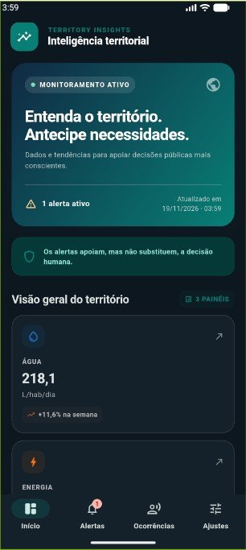

### Dashboards territoriais

#### Água
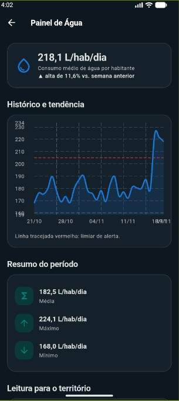
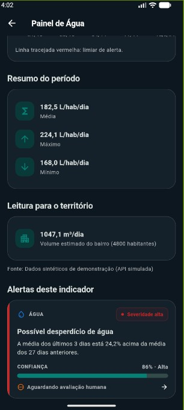

#### Energia
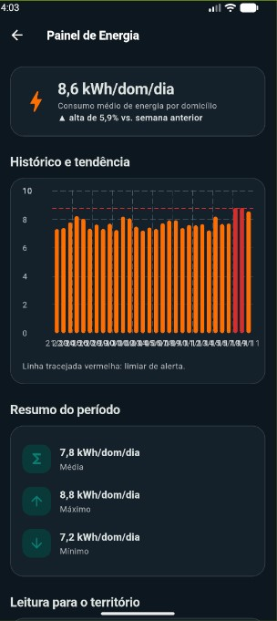
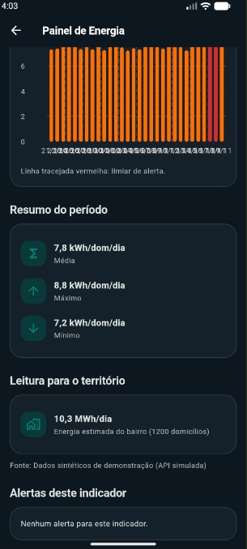

#### Clima
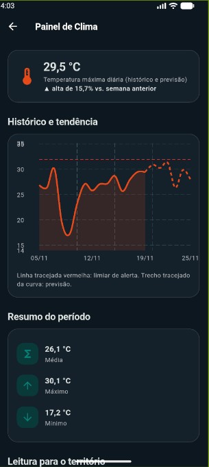
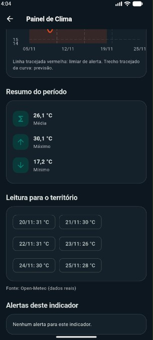

### Alertas preditivos
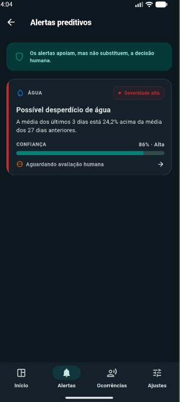
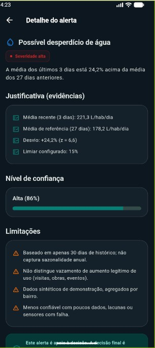

### Ocorrências
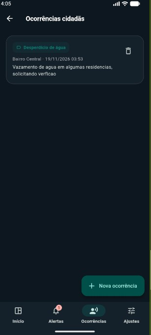
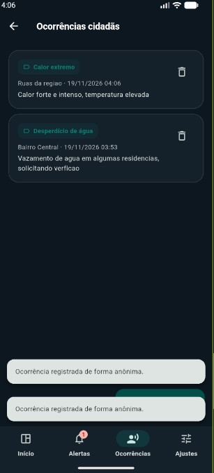
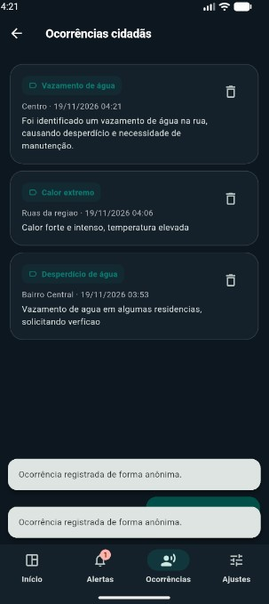
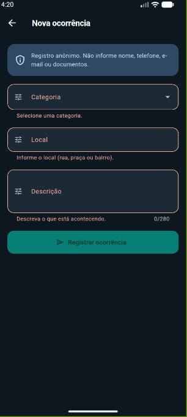

### Impacto social


### Configurações e privacidade
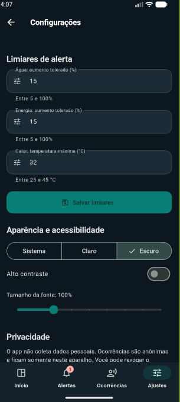
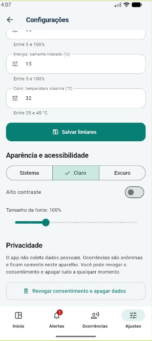

## 4. Funcionalidades

- Barra de navegação inferior (Início, Alertas, Ocorrências, Ajustes) e 8 telas com navegação por rotas nomeadas e passagem de parâmetros.
- 3 dashboards distintos (Água, Energia, Clima) com gráficos, cards, histórico e tendência.
- Alertas gerados a partir dos dados, cada um com justificativa, nível de confiança e limitações.
- Aviso visível de que os alertas apoiam, mas não substituem, a decisão humana; o gestor registra sua decisão.
- Estado global (Provider) compartilhado entre várias telas; estado local nos formulários.
- Estados de carregamento, erro (com "tentar novamente") e lista vazia.
- Dados de API real (Open-Meteo) e API simulada (água e energia).
- Persistência local (consentimento, limiares, ocorrências, decisões, preferências e cache); funciona offline.
- Formulários com validação: registro de ocorrência e limiares de alerta.
- Indicadores de benefício social na visão geral.
- Tema claro, escuro e alto contraste; fonte ajustável; descrições para leitores de tela.
- Testes automatizados da lógica de alertas, validações e widgets.
- Animação com propósito (barra de confiança).

## 5. Funcionamento offline

O aplicativo foi testado em modo avião, verificando a disponibilidade dos indicadores e das informações armazenadas localmente.

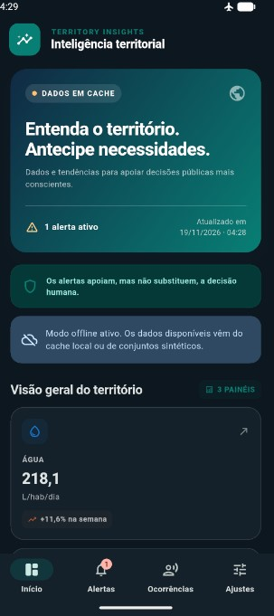

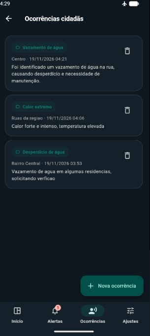

## 6. Dados e alertas

**Fontes**

- **Clima:** API pública [Open-Meteo](https://open-meteo.com/) (sem chave), temperatura máxima diária de São Paulo: 14 dias de histórico e 7 de previsão. Sem conexão, usa o último cache; sem cache, dados sintéticos.
- **Água e energia:** dados **sintéticos** determinísticos de 30 dias, servidos por uma API simulada. Representam um bairro fictício de 4.800 habitantes e 1.200 domicílios.

**Como os alertas são gerados** (`lib/services/alert_engine.dart`)

- *Consumo (água/energia):* compara a média dos últimos 3 dias com a média e o desvio-padrão dos dias anteriores. O alerta dispara se o aumento ultrapassar o limiar configurado (padrão 15%). Severidade alta se o aumento for ≥ 1,5× o limiar.
- *Calor:* dispara se a previsão de temperatura máxima nos próximos 7 dias atingir o limiar (padrão 32 °C). Severidade alta se superar o limiar em 3 °C ou mais.

**Métricas exibidas:** variação percentual, escore z, médias de referência e recente, pico previsto, horizonte da previsão e nível de confiança.

**Nível de confiança:** para consumo, cai com o ruído histórico (coeficiente de variação) e com poucos dados; para calor, cai com o horizonte da previsão (de 82% em 1 dia a 34% em 7 dias).

**Limitações e vieses**

- Só 30 dias de histórico: sem sazonalidade anual nem efeito de feriados.
- Água e energia são sintéticas: não validam o modelo com dados reais.
- A regra estatística não distingue vazamento de uso legítimo (visitas, obras, calor).
- O clima usa um ponto da cidade e ignora microclimas, umidade e sensação térmica.
- Viés de cobertura: bairros sem medidores ou sem acesso ao app ficam invisíveis nas ocorrências cidadãs.

**Quando as previsões não são confiáveis:** poucos dados ou lacunas, sensores com falha, eventos atípicos, horizonte de previsão longo e quando os dados vêm do modo sem conexão (sintético).

**Decisão humana:** nenhum alerta aciona ação automática. O gestor escolhe: acionar equipe, manter em monitoramento ou descartar.

## 7. Privacidade e inclusão

- Consentimento explícito na primeira abertura; revogável com apagamento de todos os dados em Configurações.
- Sem login, nome, telefone, e-mail ou localização exata. O formulário **bloqueia** e-mails e sequências de dígitos (telefone/documento) na descrição.
- Ocorrências ficam só no aparelho, de forma anônima.
- Acessibilidade: contraste adequado, **modo escuro e alto contraste**, fonte ajustável de 80% a 160% (somada à fonte do sistema), rótulos `Semantics` em cards, gráficos e botões, `tooltip` em ícones, alvos de toque confortáveis e layout com largura máxima para telas grandes.

## 8. Tecnologias e decisões técnicas

| Escolha | Justificativa |
|---|---|
| **Flutter / Dart** | Requisito da disciplina; um código para Android e iOS |
| **Provider** (`ChangeNotifier`) | Simples e suficiente: um `AppState` global compartilhado entre telas; estado local só nos formulários |
| **go_router** | Rotas nomeadas, parâmetros de caminho, `ShellRoute` para a barra inferior e redirecionamento (consentimento obrigatório) |
| **shared_preferences** | Persistência leve em JSON para consentimento, limiares, ocorrências, decisões e cache offline |
| **http** | Consumo da API Open-Meteo, com timeout e fallback para cache |
| **fl_chart** | Gráficos de linha e barras com linha de limiar e previsão tracejada |
| **intl** | Formatação de datas |
| Regras estatísticas (z-score e limiar) em vez de ML | Explicáveis ao gestor e adequadas a 30 dias de dados; a justificativa de cada alerta sai direto das regras |

**Estrutura:** `core/` (tema, validadores, formatação), `models/`, `services/` (dados, motor de alertas, armazenamento), `state/` (`AppState`), `screens/` e `widgets/` (componentes reutilizáveis).

## 9. Como executar

Pré-requisito: Flutter 3.24 ou superior.

Clone o repositório:

```bash
git clone https://github.com/HenrySntz/Territory-Insights-GS.git
```

Entre na pasta do projeto:

```bash
cd Territory-Insights-GS
```

Instale as dependências:

```bash
flutter pub get
```

Execute o aplicativo:

```bash
flutter run
```

Execute os testes automatizados:

```bash
flutter test
```

Gere o APK de release:

```bash
flutter build apk --release
```

**Variáveis de ambiente / chaves:** nenhuma. A Open-Meteo é aberta e não exige chave.

**Android:** confirme que `android/app/src/main/AndroidManifest.xml` contém `<uses-permission android:name="android.permission.INTERNET"/>` (necessário no APK de release).

## 10. Vídeo

🎥 [Assistir ao vídeo — Territory Insights](https://youtu.be/7g-u4wD57pQ)

## 11. Testes e validação

O projeto foi submetido a testes automatizados utilizando Flutter.

### Testes automatizados

Comando executado:

`flutter test`

Resultado: **10 testes aprovados.**

### Análise estática

Comando executado:

`flutter analyze`

Resultado: 20 informações relacionadas ao uso de APIs depreciadas do Flutter. Nenhum erro foi reportado na análise apresentada.

### Testes funcionais manuais

Foram realizados testes de:

- Navegação entre telas;
- Validação do formulário de ocorrências;
- Cadastro de ocorrências;
- Persistência dos registros após encerramento forçado;
- Visualização dos alertas;
- Funcionamento em modo offline.

## 12. Licença

Projeto acadêmico desenvolvido para a FIAP, como parte da Global Solution 2026.2, na disciplina Cross-Platform Application Development, dentro do desafio Territory Predictive Insights.

Todos os direitos relacionados ao desenvolvimento deste projeto pertencem aos seus respectivos integrantes.
